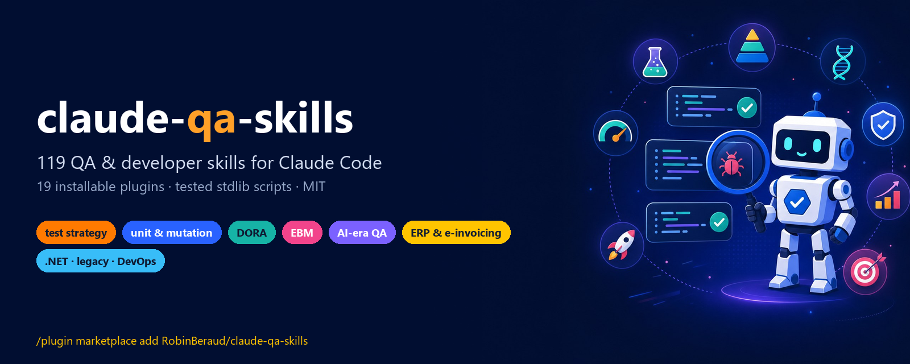
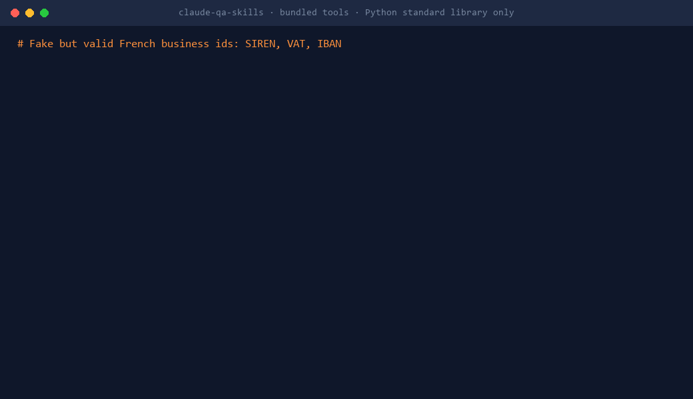

<p align="center"><a href="https://robinberaud.github.io/claude-qa-skills/"></a></p>

<p align="center">
  <a href="https://github.com/RobinBeraud/claude-qa-skills/stargazers"></a>
  
  
  
  
</p>

<p align="center">
  <b><a href="https://robinberaud.github.io/claude-qa-skills/">🌐 Website & searchable catalogue</a></b> ·
  <a href="docs/GETTING_STARTED.md">🚀 Getting started</a> ·
  <a href="docs/GUIDE_FR.md">🇫🇷 Guide en français</a> ·
  <a href="#-the-catalogue">📚 All skills</a> ·
  <a href="CONTRIBUTING.md">🤝 Contribute</a>
</p>

---

**claude-qa-skills** turns [Claude Code](https://code.claude.com) into a senior quality engineer **and a senior developer on enterprise business software**: **119 skills in 19 installable plugins**, from a fuzzy user story to a go/no-go decision. Test strategy, unit and mutation testing, exploratory testing, CI insights, **DORA metrics**, **Evidence-Based Management**, the checks that matter now that **coding agents write the code**, and, new in v1.2, **7 developer plugins** for .NET, Angular, SQL Server, legacy code, Azure DevOps delivery and secure development.

> **Why?** Agents made writing code cheap; verification became the bottleneck. These skills push Claude to plan before editing, write tests that can actually fail, show evidence before saying "done", and measure delivery instead of activity.

## ⚡ Install in 30 seconds

```text
/plugin marketplace add RobinBeraud/claude-qa-skills
/plugin install qa-test-strategy@claude-qa-skills
```

Then just ask: *"Review the testability of this story"*, *"Which tests are flaky in these JUnit reports?"*, *"Compute our DORA metrics from this export"*. Claude picks the right skill, or call one directly: `/qa-ai-era:ai-pr-review`.

<details>
<summary><b>More ways to install</b> (shell, whole team, without plugins)</summary>

```bash
# from a shell
claude plugin marketplace add RobinBeraud/claude-qa-skills
claude plugin install qa-unit-testing@claude-qa-skills

# for the whole team: run once in your repo, commit .claude/settings.json
claude plugin marketplace add RobinBeraud/claude-qa-skills --scope project
claude plugin install qa-ai-era@claude-qa-skills --scope project
```

No GitHub SSH key? Set `CLAUDE_CODE_PLUGIN_PREFER_HTTPS=1` first. Without the plugin system, copy any `plugins/<plugin>/skills/<skill>/` folder into `~/.claude/skills/`. Full guide: [docs/GETTING_STARTED.md](docs/GETTING_STARTED.md).
</details>

## 🎬 Real tools, zero dependencies

<p align="center"></p>

21 bundled scripts, **Python standard library only**, each covered by unit tests. Try them on the sample data in [`examples/`](examples) (commands in the [getting started guide](docs/GETTING_STARTED.md#5-try-the-scripts-on-the-examples-30-seconds)).

## 🛠️ New in v1.2: developer plugins

Most popular skill libraries target greenfield web stacks. Business software lives elsewhere: a 15-year-old .NET solution half on .NET Framework, Angular three majors behind, SQL Server, Azure DevOps (sometimes still TFVC), several maintained release branches, multi-tenant SaaS, French accessibility (RGAA) and data-protection (GDPR) rules, pull requests that wait for weeks. The 40 `dev-*` skills give Claude the habits of a senior developer there.

| Plugin | Highlights |
|---|---|
| `dev-workflow` | explore before editing, plan in files, root-cause debugging, **PR size budget (script)**, PR description from the diff, self-review, receiving review, worktrees, handoff |
| `dev-dotnet` | **solution inventory with support status and package drift (script)**, .NET Framework to .NET 10, modern C#, xUnit/Testcontainers, EF Core performance and migrations, NuGet |
| `dev-web` | Angular modernisation (standalone, signals, control flow), TypeScript strict step by step, WCAG 2.2 / RGAA 4.1, i18n with decimal commas and no-break spaces |
| `dev-data` | SQL Server plans and Query Store, zero-downtime schema changes, multi-tenant isolation, GDPR by design |
| `dev-legacy` | **hotspots and hidden coupling from git history (script)**, strangler fig, TFVC to Git, **fixes missing from release branches (script)**, dead code |
| `dev-delivery` | Azure Pipelines YAML, AB# linking and WIQL, **Conventional Commits and release notes (script)**, **stale PR triage for Azure DevOps, GitHub, GitLab (script)**, feature flags, incident reviews |
| `dev-security` | secure code review (.NET, Angular), STRIDE, insecure defaults, SBOM and licences, **pre-commit secret scanner (script)** |

Built after studying the most-starred skill libraries (stars as of November 2026), keeping what makes them work and writing every skill from scratch: one hard rule and a red-flags list per discipline skill ([obra/superpowers](https://github.com/obra/superpowers), 315k), the skill format and scripts for deterministic work ([anthropics/skills](https://github.com/anthropics/skills), 192k), one plugin per domain ([wshobson/agents](https://github.com/wshobson/agents), 42k), plans that live in files ([planning-with-files](https://github.com/OthmanAdi/planning-with-files), 28k), stack specialists with checkpoints ([Jeffallan/claude-skills](https://github.com/Jeffallan/claude-skills), 12k) and security procedures ([trailofbits/skills](https://github.com/trailofbits/skills), 8k).

```text
/plugin install dev-workflow@claude-qa-skills
/plugin install dev-dotnet@claude-qa-skills
```

## 🧭 Start with your role

| You are | Install these plugins | Then ask |
|---|---|---|
| **QA engineer / tester** | `qa-shift-left` · `qa-explore-and-report` · `qa-automation` | "Write exploratory charters for the payment screen" |
| **Developer** | `dev-workflow` · `qa-unit-testing` · `qa-ai-era` + your stack: `dev-dotnet` · `dev-web` · `dev-data` | "Is this branch too big for one PR?" · "Plan the .NET 10 upgrade of this solution" |
| **Team on a legacy codebase** | `dev-legacy` · `dev-delivery` · `dev-security` | "Which fixes from release/12.4 are missing in 13.0?" · "Triage our 90 open PRs" |
| **Tech lead / QA lead** | `qa-test-strategy` · `qa-ci-insights` · `qa-release` | "Write our one-page test strategy" |
| **Agile coach / manager / PO** | `dora-metrics` · `evidence-based-management` · `qa-test-strategy` | "Define EBM goals and key value measures for our product" |
| **ERP / finance / SaaS team** | `qa-business-apps` | "Check this Factur-X invoice against EN 16931" |

## ✨ What makes it different

- **Real testing craft**: SFDIPOT and testing tours, FEW HICCUPPS oracles, RIMGEA bug advocacy, example mapping, decision tables, pairwise, property-based and mutation testing, agile testing quadrants, risk storming.
- **Built for the agent era**: review AI-generated PRs, write tests before the agent implements, demand evidence before "done", audit AI-written tests with fault injection, evaluate and red-team LLM features.
- **Metrics that lead to decisions**: the five DORA metrics (with the 2024 rework rate), Evidence-Based Management across the four key value areas, quality flow metrics, and facilitation guides that resist gaming.
- **Business software, not demo apps**: accounting invariants, EN 16931 / Factur-X checks, money and rounding, dates and DST, multi-tenant isolation, RBAC matrices, data migrations, FR/ES/PT localisation.
- **Quality-checked itself**: every skill validated by `claude plugin validate` and a stricter in-repo validator; every script unit-tested.

## 📚 The catalogue

🐍 = ships a tested script. Browse and search it on the **[website](https://robinberaud.github.io/claude-qa-skills/)**.

<!-- CATALOG:START -->
### 🗺️ Test strategy: decide what quality means and how to get it

Plugin **`qa-test-strategy`** (10 skills): `/plugin install qa-test-strategy@claude-qa-skills`

| Skill | What it does | Script |
|---|---|---|
| [qa-maturity-assessment](plugins/qa-test-strategy/skills/qa-maturity-assessment/SKILL.md) | Run a lightweight QA and test maturity self-assessment for a team across 8 dimensions (strategy, shift-left, automation, CI feedback, exploratory testing, non-functional testing, defect... |  |
| [quality-attribute-scenarios](plugins/qa-test-strategy/skills/quality-attribute-scenarios/SKILL.md) | Turn quality attributes into testable scenarios with a utility tree (from the ATAM method): source, stimulus, environment, artifact, response and response measure, prioritised by... |  |
| [risk-storming-workshop](plugins/qa-test-strategy/skills/risk-storming-workshop/SKILL.md) | Facilitate a risk storming workshop (inspired by TestSphere and the risk storming format by Beren Van Daele) for a feature or release: quality aspects first, then risks per aspect, then... |  |
| [shift-right-testing](plugins/qa-test-strategy/skills/shift-right-testing/SKILL.md) | Plan shift-right testing and verification in production: feature flags and progressive delivery (canary, percentage rollout), synthetic monitoring of key journeys, observability signals... |  |
| [test-automation-roadmap](plugins/qa-test-strategy/skills/test-automation-roadmap/SKILL.md) | Decide what to automate next and in which order: score candidate test cases or journeys by frequency of execution, business risk, stability of the feature, cost to automate and flakiness... |  |
| [test-data-strategy](plugins/qa-test-strategy/skills/test-data-strategy/SKILL.md) | Define how tests get their data: synthetic generation, anonymised production extracts, fixtures per test, seeded reference data, data reset between runs, GDPR constraints on personal... |  |
| [test-environment-strategy](plugins/qa-test-strategy/skills/test-environment-strategy/SKILL.md) | Design the test environment strategy: which environments exist (ephemeral per PR, integration, staging, pre-production), what each is for, how they are created and torn down,... |  |
| [test-pyramid-assessment](plugins/qa-test-strategy/skills/test-pyramid-assessment/SKILL.md) | Measure the real shape of a repository's test suite with a bundled stdlib script: count test files and test cases classified as unit, integration/API or end-to-end from paths, names and... | 🐍 |
| [test-strategy-doc](plugins/qa-test-strategy/skills/test-strategy-doc/SKILL.md) | Write a one-page team test strategy: quality goals, test pyramid and ownership per level, what runs where in CI, environments and data, definition of done for testing, exploratory... |  |
| [testing-quadrants-map](plugins/qa-test-strategy/skills/testing-quadrants-map/SKILL.md) | Map a team's current and missing testing activities onto the Agile Testing Quadrants (Brian Marick, Lisa Crispin and Janet Gregory): technology- vs business-facing, supporting the team... |  |

### 🧭 Shift-left: test before the code exists

Plugin **`qa-shift-left`** (9 skills): `/plugin install qa-shift-left@claude-qa-skills`

| Skill | What it does | Script |
|---|---|---|
| [example-mapping](plugins/qa-shift-left/skills/example-mapping/SKILL.md) | Prepare or run an Example Mapping (Three Amigos) session for a story: rules, concrete examples per rule, and open questions, then turn the result into scenarios. |  |
| [gherkin-scenarios](plugins/qa-shift-left/skills/gherkin-scenarios/SKILL.md) | Write clean, business-readable Gherkin (Given/When/Then) scenarios and scenario outlines from acceptance criteria or examples, then lint them with a bundled script (one When per... | 🐍 |
| [nfr-checklist](plugins/qa-shift-left/skills/nfr-checklist/SKILL.md) | Turn vague non-functional expectations into measurable, testable quality requirements using ISO/IEC 25010 characteristics: performance, reliability, security, usability, accessibility,... |  |
| [pairwise-combinations](plugins/qa-shift-left/skills/pairwise-combinations/SKILL.md) | Generate a small all-pairs (pairwise) test set covering every pair of parameter values, with a bundled stdlib Python script, plus constraints to exclude impossible combinations. | 🐍 |
| [risk-based-test-plan](plugins/qa-shift-left/skills/risk-based-test-plan/SKILL.md) | Build a lean, risk-based test plan for a feature, epic or release: scope, risk matrix (impact x likelihood), test approach per risk, test types, data, environments, entry and exit criteria. |  |
| [story-testability-review](plugins/qa-shift-left/skills/story-testability-review/SKILL.md) | Review a user story, PBI or ticket for testability before development starts: ambiguous words, missing acceptance criteria, untestable rules, hidden edge cases, and a rewrite in... |  |
| [test-case-export](plugins/qa-shift-left/skills/test-case-export/SKILL.md) | Convert test cases written in Markdown or JSON into import-ready CSV for Azure DevOps Test Plans or Jira Xray (steps with action and expected result), with a bundled stdlib script. | 🐍 |
| [test-data-fr](plugins/qa-shift-left/skills/test-data-fr/SKILL.md) | Generate realistic but fake French business test data that passes real validation: SIREN/SIRET (Luhn), intra-EU VAT numbers, IBAN FR with RIB key, invoices with VAT rates 20/10/5.5/2.1... | 🐍 |
| [test-design-techniques](plugins/qa-shift-left/skills/test-design-techniques/SKILL.md) | Derive test cases systematically with equivalence partitioning, boundary value analysis, decision tables, state transitions and cause-effect reasoning, then output a compact,... |  |

### 🧪 Unit testing and TDD

Plugin **`qa-unit-testing`** (6 skills): `/plugin install qa-unit-testing@claude-qa-skills`

| Skill | What it does | Script |
|---|---|---|
| [assertion-quality](plugins/qa-unit-testing/skills/assertion-quality/SKILL.md) | Improve assertions so failures explain themselves and tests check what matters: precise matchers, whole-object comparison over field-by-field noise, custom assertion helpers, approximate... |  |
| [parameterized-tests](plugins/qa-unit-testing/skills/parameterized-tests/SKILL.md) | Collapse repetitive unit tests into parameterised, table-driven tests (pytest.mark.parametrize, JUnit @ParameterizedTest, xUnit Theory/InlineData, Jest test.each, Go table tests) with... |  |
| [tdd-red-green-refactor](plugins/qa-unit-testing/skills/tdd-red-green-refactor/SKILL.md) | Drive a change with test-driven development in short red-green-refactor cycles, with Claude as a disciplined pair: write one failing test, the minimum code to pass, refactor with tests... |  |
| [test-doubles-chooser](plugins/qa-unit-testing/skills/test-doubles-chooser/SKILL.md) | Choose and write the right test double (dummy, stub, spy, mock, fake) for each collaborator of the unit under test, avoid over-mocking, and prefer fakes or real objects where cheap;... |  |
| [testability-refactoring](plugins/qa-unit-testing/skills/testability-refactoring/SKILL.md) | Make hard-to-test or legacy code unit-testable with safe, small refactorings (Michael Feathers' seams): extract method, inject dependencies, wrap static and global calls, introduce an... |  |
| [unit-test-writer](plugins/qa-unit-testing/skills/unit-test-writer/SKILL.md) | Write focused unit tests for a function, class or module: one behaviour per test, Arrange-Act-Assert, descriptive names, boundary and error cases, no I/O, fast and deterministic; in the... |  |

### 🧬 Mutation testing: do the tests really check anything?

Plugin **`qa-mutation-testing`** (6 skills): `/plugin install qa-mutation-testing@claude-qa-skills`

| Skill | What it does | Script |
|---|---|---|
| [equivalent-mutant-check](plugins/qa-mutation-testing/skills/equivalent-mutant-check/SKILL.md) | Decide whether a surviving mutant is equivalent (no observable behaviour change, so no test can kill it) or a real gap, using reasoning about reachable inputs, side effects and... |  |
| [mutant-killer-tests](plugins/qa-mutation-testing/skills/mutant-killer-tests/SKILL.md) | Write the smallest, clearest tests that kill a list of surviving mutants (from a report or a triage), one behaviour per test, reusing existing fixtures, then re-run mutation testing on... |  |
| [mutation-report-digest](plugins/qa-mutation-testing/skills/mutation-report-digest/SKILL.md) | Summarise a mutation testing report (Stryker mutation-testing-report-schema JSON, used by StrykerJS, Stryker.NET and Stryker4s, or PIT mutations.xml) with a bundled stdlib script: score... | 🐍 |
| [mutation-score-gate](plugins/qa-mutation-testing/skills/mutation-score-gate/SKILL.md) | Add a pragmatic mutation-testing quality gate to CI: incremental mutation on changed files only (Stryker --incremental / since, PIT with scmMutationCoverage or history), a threshold on... |  |
| [mutation-testing-setup](plugins/qa-mutation-testing/skills/mutation-testing-setup/SKILL.md) | Set up mutation testing for a project: pick the tool for the stack (Stryker for JS/TS and .NET, PIT for Java/Kotlin, mutmut or cosmic-ray for Python, Infection for PHP, go-mutesting for... |  |
| [surviving-mutant-triage](plugins/qa-mutation-testing/skills/surviving-mutant-triage/SKILL.md) | Triage surviving mutants one by one: classify each as missing assertion, missing test case, equivalent mutant, or dead/unreachable code, explain why the tests did not notice the change,... |  |

### 🤖 Automation that stays green for the right reasons

Plugin **`qa-automation`** (9 skills): `/plugin install qa-automation@claude-qa-skills`

| Skill | What it does | Script |
|---|---|---|
| [accessibility-audit](plugins/qa-automation/skills/accessibility-audit/SKILL.md) | Audit a web page or flow for accessibility against WCAG 2.2 AA and the French RGAA 4.1: automated axe-core scan through Playwright, plus the manual checks automation cannot do (keyboard,... |  |
| [api-test-suite](plugins/qa-automation/skills/api-test-suite/SKILL.md) | Generate an API test suite from an OpenAPI/Swagger spec or from example requests: happy paths, status codes, schema validation, authentication and authorization, validation errors,... |  |
| [characterization-tests](plugins/qa-automation/skills/characterization-tests/SKILL.md) | Pin down the current behaviour of legacy or untested code with characterization (golden master / approval) tests before refactoring or letting an agent change it: capture outputs for a... |  |
| [contract-testing](plugins/qa-automation/skills/contract-testing/SKILL.md) | Set up consumer-driven contract tests (Pact or schema-based) between a front end or service and the APIs it consumes, so breaking changes are caught in CI before deployment. |  |
| [performance-test-k6](plugins/qa-automation/skills/performance-test-k6/SKILL.md) | Design and script load, stress and soak tests with k6 (or Locust/Gatling if the team uses them): realistic scenarios, think time, thresholds on p95/p99 and error rate, and a readable... |  |
| [playwright-e2e](plugins/qa-automation/skills/playwright-e2e/SKILL.md) | Write or fix Playwright end-to-end tests (TypeScript or Python) with user-facing locators, web-first assertions, isolated test data and no fixed sleeps, then run them and iterate until... |  |
| [property-based-tests](plugins/qa-automation/skills/property-based-tests/SKILL.md) | Write property-based tests (Hypothesis for Python, fast-check for JS/TS, jqwik or FsCheck for JVM/.NET) that state invariants and let the framework search for counter-examples. |  |
| [test-smell-review](plugins/qa-automation/skills/test-smell-review/SKILL.md) | Review an existing test suite or a test file for smells that make tests useless or flaky: no or weak assertions, sleeps, order dependence, shared mutable state, logic in tests,... |  |
| [visual-regression](plugins/qa-automation/skills/visual-regression/SKILL.md) | Add visual regression tests (Playwright toHaveScreenshot, or Percy/Chromatic/BackstopJS) on stable components and key screens, with masked dynamic areas, fixed viewports and a review... |  |

### 🔎 Explore and report

Plugin **`qa-explore-and-report`** (6 skills): `/plugin install qa-explore-and-report@claude-qa-skills`

| Skill | What it does | Script |
|---|---|---|
| [bug-report](plugins/qa-explore-and-report/skills/bug-report/SKILL.md) | Write a clear, reproducible bug report from rough notes, logs, screenshots descriptions or a conversation: title that states the failure, minimal steps, expected vs actual, environment,... |  |
| [bug-triage](plugins/qa-explore-and-report/skills/bug-triage/SKILL.md) | Triage a batch of incoming bugs or a bug backlog export: detect likely duplicates, missing information, misfiled components, severity inconsistencies and stale items, then propose a... |  |
| [exploratory-charter](plugins/qa-explore-and-report/skills/exploratory-charter/SKILL.md) | Create focused exploratory testing charters ("Explore <target> with <resources> to discover <information>") using the SFDIPOT product elements and Whittaker's testing tours, with... |  |
| [oracle-heuristics](plugins/qa-explore-and-report/skills/oracle-heuristics/SKILL.md) | Decide whether an observed behaviour is a bug when there is no spec, using Michael Bolton's FEW HICCUPPS consistency oracles (familiar problems, explainability, world, history, image,... |  |
| [repro-minimizer](plugins/qa-explore-and-report/skills/repro-minimizer/SKILL.md) | Shrink a failing scenario to the smallest reproduction: fewer steps, smaller data, fewer settings, by delta-debugging style halving, and identify the trigger condition. |  |
| [session-debrief](plugins/qa-explore-and-report/skills/session-debrief/SKILL.md) | Turn raw exploratory session notes (bullet notes, screenshots descriptions, chat logs) into a session-based test management debrief: coverage, bugs, issues, questions, time split and... |  |

### 📈 CI insights

Plugin **`qa-ci-insights`** (5 skills): `/plugin install qa-ci-insights@claude-qa-skills`

| Skill | What it does | Script |
|---|---|---|
| [ci-failure-triage](plugins/qa-ci-insights/skills/ci-failure-triage/SKILL.md) | Triage a failed CI pipeline from its logs: classify each failure as product bug, test bug, flaky test, environment/infrastructure or dependency issue, find the first real error in long... |  |
| [coverage-gap-analysis](plugins/qa-ci-insights/skills/coverage-gap-analysis/SKILL.md) | Read a code coverage report (Cobertura, JaCoCo, lcov, coverage.py) together with risk signals (business-critical modules, recent bugs, churn) and recommend where new tests pay off most,... |  |
| [flaky-test-hunter](plugins/qa-ci-insights/skills/flaky-test-hunter/SKILL.md) | Find flaky tests by comparing JUnit XML reports from several CI runs of the same code: pass/fail flips, flip rate, failure messages, and a quarantine shortlist, using a bundled stdlib... | 🐍 |
| [junit-digest](plugins/qa-ci-insights/skills/junit-digest/SKILL.md) | Summarise one or many JUnit/xUnit XML test reports into a short digest: totals, failures grouped by error message, slowest tests and suites, skipped tests, using a bundled stdlib script. | 🐍 |
| [regression-scope](plugins/qa-ci-insights/skills/regression-scope/SKILL.md) | Select the regression tests a change most likely needs, from the files changed in a branch or PR: name-matching test files plus tests that historically change together with those files... | 🐍 |

### 🚀 Release with evidence

Plugin **`qa-release`** (4 skills): `/plugin install qa-release@claude-qa-skills`

| Skill | What it does | Script |
|---|---|---|
| [escaped-defect-rca](plugins/qa-release/skills/escaped-defect-rca/SKILL.md) | Run a blameless root-cause analysis of a defect that reached production: timeline, how it was introduced, why each test layer and review missed it, contributing factors, and concrete... |  |
| [post-deploy-smoke](plugins/qa-release/skills/post-deploy-smoke/SKILL.md) | Design a short post-deployment smoke and verification plan: the 10-20 checks that prove a deployment is healthy in minutes (critical journeys, integrations, background jobs, monitoring... |  |
| [qa-flow-metrics](plugins/qa-release/skills/qa-flow-metrics/SKILL.md) | Compute quality flow metrics from a work-item export (Azure DevOps or Jira CSV): bugs created vs closed per month, open bug backlog, median time to fix, escape rate to production, reopen... | 🐍 |
| [release-readiness](plugins/qa-release/skills/release-readiness/SKILL.md) | Produce a go/no-go release readiness report from test results, open bugs, story status and known risks: what was tested, what was not, open defects by severity, risks with mitigation,... |  |

### 📊 DORA metrics: software delivery performance

Plugin **`dora-metrics`** (5 skills): `/plugin install dora-metrics@claude-qa-skills`

| Skill | What it does | Script |
|---|---|---|
| [dora-capabilities-plan](plugins/dora-metrics/skills/dora-capabilities-plan/SKILL.md) | Build an improvement plan from the DORA research capabilities (technical: CI, trunk-based development, test automation, deployment automation, loosely coupled architecture, database... |  |
| [dora-data-sources](plugins/dora-metrics/skills/dora-data-sources/SKILL.md) | Find and define where each DORA metric's data comes from in the team's tools (Azure DevOps pipelines and releases, GitHub Actions and deployments API, GitLab environments, Jira,... |  |
| [dora-metrics-calculator](plugins/dora-metrics/skills/dora-metrics-calculator/SKILL.md) | Compute the five DORA software delivery metrics from CSV exports with a bundled stdlib script: deployment frequency, change lead time, change fail rate, failed deployment recovery time... | 🐍 |
| [dora-metrics-review](plugins/dora-metrics/skills/dora-metrics-review/SKILL.md) | Facilitate a monthly DORA metrics review that leads to learning instead of gaming: trends with context, throughput and instability read together, outliers explained by the team, one... |  |
| [dora-quick-check](plugins/dora-metrics/skills/dora-quick-check/SKILL.md) | Run a quick, survey-based DORA estimate when no tooling data exists: ask the team the four classic questions (deployment frequency, lead time, change fail rate, recovery time) with the... |  |

### 🎯 Evidence-Based Management: value, not output

Plugin **`evidence-based-management`** (5 skills): `/plugin install evidence-based-management@claude-qa-skills`

| Skill | What it does | Script |
|---|---|---|
| [ebm-experiment-loop](plugins/evidence-based-management/skills/ebm-experiment-loop/SKILL.md) | Run hypothesis-driven experiments in the EBM loop: from a goal and its measures, write a falsifiable hypothesis, define the smallest experiment, the measure and threshold that would... |  |
| [ebm-goals](plugins/evidence-based-management/skills/ebm-goals/SKILL.md) | Define an Evidence-Based Management goal structure for a product or organisation: a strategic goal, intermediate goals and immediate tactical goals, each stated as a measurable outcome... |  |
| [ebm-key-value-measures](plugins/evidence-based-management/skills/ebm-key-value-measures/SKILL.md) | Choose a small, balanced set of key value measures across the four EBM key value areas (Current Value, Unrealized Value, Time to Market, Ability to Innovate) from the EBM guide's... |  |
| [ebm-review](plugins/evidence-based-management/skills/ebm-review/SKILL.md) | Facilitate an Evidence-Based Management review with stakeholders (monthly or quarterly): progress toward goals, key value area signals, results of experiments, decisions on investment... |  |
| [ebm-scorecard](plugins/evidence-based-management/skills/ebm-scorecard/SKILL.md) | Track Evidence-Based Management measures over time with a bundled stdlib script: from a CSV of measurements (period, key value area, measure, value, direction) it computes the latest... | 🐍 |

### 🧠 Quality in the age of coding agents

Plugin **`qa-ai-era`** (6 skills): `/plugin install qa-ai-era@claude-qa-skills`

| Skill | What it does | Script |
|---|---|---|
| [ai-pr-review](plugins/qa-ai-era/skills/ai-pr-review/SKILL.md) | Review a pull request written with a coding agent (Claude Code, Copilot, Cursor) against its brief: scope creep, acceptance criteria actually covered by tests, weak or mirrored tests,... |  |
| [ai-tests-audit](plugins/qa-ai-era/skills/ai-tests-audit/SKILL.md) | Audit a test suite or a batch of tests written by an AI agent: do they fail when the code is wrong? Combine a test-smell scan, a deliberate fault-injection (mini mutation) pass on the... |  |
| [done-evidence-check](plugins/qa-ai-era/skills/done-evidence-check/SKILL.md) | Refuse "it should work": before a task, PR or story is called done, collect the evidence: build and test commands actually run with their output, each acceptance criterion mapped to... |  |
| [llm-feature-eval](plugins/qa-ai-era/skills/llm-feature-eval/SKILL.md) | Design and run an evaluation suite for a product feature built on an LLM (summary, classification, extraction, chat assistant): golden dataset, rubric and graders (exact match, schema,... |  |
| [prompt-injection-redteam](plugins/qa-ai-era/skills/prompt-injection-redteam/SKILL.md) | Red-team an LLM feature or agent against prompt injection and data exfiltration: direct and indirect injection (documents, e-mails, web pages, tool outputs), instruction override, system... |  |
| [tests-first-for-agents](plugins/qa-ai-era/skills/tests-first-for-agents/SKILL.md) | Before letting a coding agent implement a story, turn its acceptance criteria into failing tests (unit or API level), get them reviewed by a human, then hand the agent the brief plus the... |  |

### 🏦 Business software: ERP, accounting, e-invoicing, SaaS

Plugin **`qa-business-apps`** (8 skills): `/plugin install qa-business-apps@claude-qa-skills`

| Skill | What it does | Script |
|---|---|---|
| [accounting-invariants](plugins/qa-business-apps/skills/accounting-invariants/SKILL.md) | Derive and test the invariants accounting and finance software must never break: balanced double entries, trial balance, sequential numbering without gaps, closed periods immutable, VAT... |  |
| [data-migration-validation](plugins/qa-business-apps/skills/data-migration-validation/SKILL.md) | Validate a data migration or upgrade (legacy to new system, version upgrade, tenant onboarding): reconciliation of counts, totals and checksums per entity, sampling with field-level... |  |
| [date-time-edge-cases](plugins/qa-business-apps/skills/date-time-edge-cases/SKILL.md) | Generate the date and time test cases that break business software: time zones and DST changes, end of month and leap years, fiscal years not aligned with calendar years, cut-off times,... |  |
| [einvoice-consistency](plugins/qa-business-apps/skills/einvoice-consistency/SKILL.md) | Check an electronic invoice in UN/CEFACT CII XML or a Factur-X PDF for EN 16931 arithmetic and mandatory-field consistency (line totals, VAT breakdown, tax basis, grand total, amount... | 🐍 |
| [localization-testing](plugins/qa-business-apps/skills/localization-testing/SKILL.md) | Test localisation and internationalisation for French, Spanish and Portuguese markets (and others): translations complete and in context, number, currency, date and address formats,... |  |
| [money-and-rounding](plugins/qa-business-apps/skills/money-and-rounding/SKILL.md) | Design tests for monetary calculations: decimal precision, rounding modes (half-up, half-even, truncation), per-line vs per-document VAT rounding, allocation of remainders (splitting... |  |
| [multi-tenant-isolation](plugins/qa-business-apps/skills/multi-tenant-isolation/SKILL.md) | Test that a multi-tenant SaaS never leaks or mixes data between tenants (customers, companies, subsidiaries): ID guessing on APIs, list filters, search indexes, exports, caches,... |  |
| [permissions-matrix](plugins/qa-business-apps/skills/permissions-matrix/SKILL.md) | Turn a roles x actions permission matrix (CSV) into positive and negative test cases, and compare expected permissions with observed results from a test run to list every mismatch, with... | 🐍 |

### 🧭 Developer workflow: explore, plan, debug, prove, ship small PRs

Plugin **`dev-workflow`** (9 skills): `/plugin install dev-workflow@claude-qa-skills`

| Skill | What it does | Script |
|---|---|---|
| [explore-before-editing](plugins/dev-workflow/skills/explore-before-editing/SKILL.md) | Build a working map of an unfamiliar codebase before changing it: entry points, layers, conventions, build and test commands, where the change belongs, and what could break. |  |
| [parallel-worktrees](plugins/dev-workflow/skills/parallel-worktrees/SKILL.md) | Work on several branches or let several agents work in parallel without collisions using git worktrees: one folder per task, shared object store, per-worktree build outputs, safe cleanup. |  |
| [plan-in-files](plugins/dev-workflow/skills/plan-in-files/SKILL.md) | Plan multi-step work in a markdown file kept in the repository: goal, constraints, task list with the test that proves each task, decisions log and progress, updated as you go so work... |  |
| [pr-description](plugins/dev-workflow/skills/pr-description/SKILL.md) | Write a pull request description from the actual diff and the work item: why (problem and link), what changed, how it was tested with evidence, risks and rollback, what reviewers should... |  |
| [receive-review](plugins/dev-workflow/skills/receive-review/SKILL.md) | Handle code review feedback rigorously: understand each comment, verify the claim against the code before agreeing, fix or push back with evidence, answer every thread, and avoid both... |  |
| [root-cause-debugging](plugins/dev-workflow/skills/root-cause-debugging/SKILL.md) | Debug by finding the root cause before changing code: reproduce, read the full error, check what changed, form one hypothesis at a time and test it, write the failing test, then fix;... |  |
| [self-review](plugins/dev-workflow/skills/self-review/SKILL.md) | Review your own diff before asking anyone else: read it as a reviewer would, file by file, against a checklist (correctness, edge cases, errors, tests, security, performance, naming,... |  |
| [session-handoff](plugins/dev-workflow/skills/session-handoff/SKILL.md) | Hand off work between sessions, people or agents without losing context: a short handoff note with goal, state, what was verified, what is left, decisions, gotchas and the exact next... |  |
| [small-pull-requests](plugins/dev-workflow/skills/small-pull-requests/SKILL.md) | Keep pull requests small and reviewable: measure a diff against a size budget with a bundled script (lines, files, areas touched, generated or lock files excluded), and split oversized... | 🐍 |

### 🟣 .NET and C#: inventory, upgrade, modern C#, tests, EF Core, NuGet

Plugin **`dev-dotnet`** (7 skills): `/plugin install dev-dotnet@claude-qa-skills`

| Skill | What it does | Script |
|---|---|---|
| [dotnet-solution-inventory](plugins/dev-dotnet/skills/dotnet-solution-inventory/SKILL.md) | Inventory a .NET solution with a bundled stdlib script: every project with its SDK style, target frameworks with their support status (net48, net8.0, net10.0...), output type, project... | 🐍 |
| [dotnet-testing](plugins/dev-dotnet/skills/dotnet-testing/SKILL.md) | Write effective .NET tests: xUnit, NUnit or MSTest conventions of the repo, Arrange-Act-Assert, test data builders, fakes over mocks, integration tests with WebApplicationFactory and... |  |
| [dotnet-upgrade](plugins/dev-dotnet/skills/dotnet-upgrade/SKILL.md) | Plan and run an incremental upgrade from .NET Framework or an old .NET version to the current LTS: assessment (APIs, packages, blockers like System.Web, WCF, WebForms), SDK-style... |  |
| [ef-core-migrations](plugins/dev-dotnet/skills/ef-core-migrations/SKILL.md) | Create and ship Entity Framework Core migrations safely: review the generated SQL, expand and contract for zero-downtime changes (add nullable column, backfill, switch, then drop), data... |  |
| [ef-core-performance](plugins/dev-dotnet/skills/ef-core-performance/SKILL.md) | Find and fix Entity Framework Core performance problems: N+1 queries, missing AsNoTracking, client-side evaluation, cartesian explosion (AsSplitQuery), unbounded result sets, missing... |  |
| [modern-csharp](plugins/dev-dotnet/skills/modern-csharp/SKILL.md) | Write and review modern, safe C#: nullable reference types enabled gradually, async/await without deadlocks or fire-and-forget, cancellation tokens, IDisposable and IAsyncDisposable,... |  |
| [nuget-hygiene](plugins/dev-dotnet/skills/nuget-hygiene/SKILL.md) | Keep NuGet dependencies safe and tidy: list vulnerable, deprecated and outdated packages with the dotnet CLI, check licences, adopt Central Package Management, lock files for... |  |

### 🌐 Web front-end: Angular, TypeScript, accessibility (RGAA), i18n

Plugin **`dev-web`** (4 skills): `/plugin install dev-web@claude-qa-skills`

| Skill | What it does | Script |
|---|---|---|
| [accessibility-rgaa](plugins/dev-web/skills/accessibility-rgaa/SKILL.md) | Check and fix web accessibility against WCAG 2.2 AA and the French RGAA 4.1 (mandatory for public-sector customers and large companies in France): semantic HTML, keyboard navigation and... |  |
| [angular-modernize](plugins/dev-web/skills/angular-modernize/SKILL.md) | Modernise an Angular application step by step: version-by-version upgrades with ng update, standalone components, signals and the new control flow, inject() function, typed reactive... |  |
| [i18n-l10n](plugins/dev-web/skills/i18n-l10n/SKILL.md) | Internationalise and localise business software correctly: externalised strings with ICU plural and gender rules, locale-aware dates, numbers and currencies (fr-FR decimal comma and... |  |
| [typescript-strict](plugins/dev-web/skills/typescript-strict/SKILL.md) | Turn on TypeScript strictness in an existing codebase without a big-bang: measure errors per flag, enable flags one at a time (noImplicitAny, strictNullChecks, ...), fix by folder with a... |  |

### 🗄️ Data: SQL Server, schema changes, multi-tenant, GDPR

Plugin **`dev-data`** (4 skills): `/plugin install dev-data@claude-qa-skills`

| Skill | What it does | Script |
|---|---|---|
| [gdpr-by-design](plugins/dev-data/skills/gdpr-by-design/SKILL.md) | Build GDPR (RGPD) compliance into code: map personal data in the schema, minimise what is collected, retention periods with automatic purge, pseudonymisation and encryption, access and... |  |
| [multi-tenant-safety](plugins/dev-data/skills/multi-tenant-safety/SKILL.md) | Prevent data leaks between customers in multi-tenant applications: find every query, cache key, file path, search index, background job and log that must carry the tenant, check global... |  |
| [sql-server-tuning](plugins/dev-data/skills/sql-server-tuning/SKILL.md) | Diagnose and fix slow SQL Server queries: read the actual execution plan, find scans, key lookups, spills and bad estimates, use Query Store to find regressions and plan changes, handle... |  |
| [zero-downtime-schema](plugins/dev-data/skills/zero-downtime-schema/SKILL.md) | Change a production database schema without downtime or data loss: expand and contract, backward-compatible steps across deployments, batched backfills, online index operations, renames... |  |

### 🏚️ Legacy code: hotspots, characterisation tests, strangler fig, TFVC, backports

Plugin **`dev-legacy`** (5 skills): `/plugin install dev-legacy@claude-qa-skills`

| Skill | What it does | Script |
|---|---|---|
| [codebase-hotspots](plugins/dev-legacy/skills/codebase-hotspots/SKILL.md) | Find where a legacy codebase hurts with a bundled stdlib script over git history: files ranked by change frequency x size (hotspots), number of authors, recent activity, and files that... | 🐍 |
| [dead-code-removal](plugins/dev-legacy/skills/dead-code-removal/SKILL.md) | Remove dead code, unused dependencies and obsolete feature flags safely: find candidates with compiler and IDE analysis, coverage and production telemetry, verify nothing calls them... |  |
| [release-backports](plugins/dev-legacy/skills/release-backports/SKILL.md) | Manage fixes across several maintained release branches: decide where a fix must go, cherry-pick or merge forward in a consistent direction, track which fixes are missing from which... | 🐍 |
| [strangler-fig](plugins/dev-legacy/skills/strangler-fig/SKILL.md) | Replace a legacy system or module incrementally with the strangler fig pattern: facade or proxy in front, route one capability at a time to the new implementation, keep data in sync,... |  |
| [tfvc-to-git](plugins/dev-legacy/skills/tfvc-to-git/SKILL.md) | Migrate source code from TFVC (Team Foundation Version Control) to Git in Azure DevOps: choose history depth (tip only, recent history or full via git-tfs), map TFVC branches to Git... |  |

### 🚚 Delivery: Azure Pipelines, work items, changelog, stale PRs, flags, incidents

Plugin **`dev-delivery`** (6 skills): `/plugin install dev-delivery@claude-qa-skills`

| Skill | What it does | Script |
|---|---|---|
| [azure-pipelines](plugins/dev-delivery/skills/azure-pipelines/SKILL.md) | Write and fix Azure DevOps YAML pipelines: stages, jobs and templates for reuse, caching NuGet and npm, test results and coverage publishing, environments with approvals and checks,... |  |
| [conventional-commits](plugins/dev-delivery/skills/conventional-commits/SKILL.md) | Write commit messages that tools and humans can use: Conventional Commits (feat, fix, refactor, perf, test, docs, build, ci, chore; scope; breaking changes), lint them and generate a... | 🐍 |
| [feature-flags](plugins/dev-delivery/skills/feature-flags/SKILL.md) | Use feature flags to ship safely: choose the flag type (release, experiment, operational kill switch, permission or tenant), implement with a flag library or Azure App Configuration,... |  |
| [incident-review](plugins/dev-delivery/skills/incident-review/SKILL.md) | Run a blameless post-incident review: factual timeline from logs and chat, impact in customer terms, contributing factors (not a single root cause or a person), what helped and what... |  |
| [stale-pr-triage](plugins/dev-delivery/skills/stale-pr-triage/SKILL.md) | Triage the open pull request backlog: from an exported list (Azure DevOps, GitHub or GitLab JSON) compute age, idle time, draft status, reviewer load and size buckets with a bundled... | 🐍 |
| [work-item-linking](plugins/dev-delivery/skills/work-item-linking/SKILL.md) | Link code to work items and query Azure DevOps Boards from the command line: AB#id mentions in commits and pull requests, branch naming by work item, az boards and az repos CLI commands,... |  |

### 🔐 Secure development: code review, threat model, defaults, supply chain, secrets

Plugin **`dev-security`** (5 skills): `/plugin install dev-security@claude-qa-skills`

| Skill | What it does | Script |
|---|---|---|
| [insecure-defaults](plugins/dev-security/skills/insecure-defaults/SKILL.md) | Hunt for insecure defaults and configuration in an application and its infrastructure code: debug mode and detailed errors in production, permissive CORS, missing security headers, weak... |  |
| [secrets-hygiene](plugins/dev-security/skills/secrets-hygiene/SKILL.md) | Keep secrets out of code, history and logs: scan a diff, staged files or a whole repository with a bundled stdlib scanner (cloud keys, tokens, connection strings with passwords, private... | 🐍 |
| [secure-code-review](plugins/dev-security/skills/secure-code-review/SKILL.md) | Review a diff or a module for security flaws, focused on business web applications: broken access control and IDOR, injection (SQL, command, LDAP, XPath), XSS in Angular templates and... |  |
| [supply-chain](plugins/dev-security/skills/supply-chain/SKILL.md) | Check the software supply chain of a project: generate an SBOM (CycloneDX or SPDX), list vulnerable and abandoned dependencies, licences incompatible with distribution to customers,... |  |
| [threat-model](plugins/dev-security/skills/threat-model/SKILL.md) | Threat model a feature or architecture with STRIDE before building it: data flow diagram with trust boundaries, threats per element (spoofing, tampering, repudiation, information... |  |

<!-- CATALOG:END -->

## 🗂️ Repository layout

```
.claude-plugin/marketplace.json      the marketplace (19 plugins)
plugins/<plugin>/.claude-plugin/     plugin manifest (name, version)
plugins/<plugin>/skills/<skill>/     SKILL.md (+ scripts/)
examples/                            sample data for every script
docs/                                website (GitHub Pages), guides EN/FR, images
tests/                               unit tests of every script (stdlib unittest)
tools/                               validator, README/site builders, demo GIF and banner makers
```

## 🤝 Contributing

Ideas and pull requests are welcome: a skill you keep explaining to Claude, a missing test technique, a stack-specific variant. See [CONTRIBUTING.md](CONTRIBUTING.md). Before pushing: `python tools/validate_skills.py`, `python -m unittest discover -s tests`, `claude plugin validate .`.

## ⭐ Star history

If these skills save you time, a star helps other testers and developers find them.

<a href="https://star-history.com/#RobinBeraud/claude-qa-skills&Date"></a>

## 👤 Author

Made by **[Robin Béraud-Sudreau](https://coach-agile.com)**: agile and DevOps coach, Head of AI Transformation, author of *Build Your Own AI Workforce*. Sister project: **[hermes-skills](https://github.com/RobinBeraud/hermes-skills)** for Hermes Agent.

MIT licence. Not affiliated with Anthropic.
